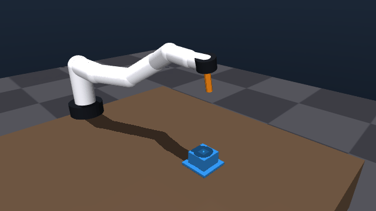

# Franka Panda Contact Assembly

[](https://github.com/haoyu020206-netizen/panda-contact-assembly/actions/workflows/ci.yml)
[](https://www.python.org/)
[](https://mujoco.org/)
[](LICENSE)

A reproducible MuJoCo control benchmark for a 7-DoF Panda-style arm: joint trajectory tracking, Cartesian impedance control, contact-aware peg-in-hole insertion, and automated robustness evaluation.

这是有意收敛范围的 Python + MuJoCo MVP；ROS2、视觉、强化学习和真机部署留作后续扩展。

GitHub Actions 会在标准 Linux runner 上执行 lint、单元测试、关节/笛卡尔/插孔实验和完整鲁棒性批次，并保存可下载的 CSV、JSON 与 PNG 结果，确保仓库不是“只能看、不能跑”的演示代码。

## Verified results




以下结果由 [GitHub Actions run 43959488539](https://github.com/haoyu020206-netizen/panda-contact-assembly/actions/runs/43959488539) 在 Python 3.12 / Ubuntu runner 上重新生成，不是手工填写的示例数据。

| Experiment | Result | Tracking error | Contact / task metric |
| --- | ---: | ---: | ---: |
| Joint trajectory | Pass | RMS **0.0118 rad**, max **0.0245 rad** | 5.0 s run |
| Cartesian impedance | Pass | RMS position **13.1 mm**, RMS orientation **3.14 mrad** | max position error 16.9 mm |
| Nominal peg insertion | Pass | final XY error **0.117 mm** | **45.6 N** peak, **7.852 s**, 58.0 mm depth |
| Robustness batch | **6 / 8 (75%)** | pose, friction, and tool-mass variations | mean peak force 98.6 N |

The asymmetric result is intentional evidence rather than a hidden failure: a +2 mm X fixture error failed while a -2 mm Y error passed, exposing direction-dependent sensitivity in the current kinematics/controller. The 5.5 mm combined disturbance also failed. See the committed [batch data](docs/results/robustness/batch_summary.csv) and [result provenance](docs/results/README.md).


## 已实现

- 自带无网格依赖的 7-DoF Panda 风格 MJCF，可立即验证控制代码；
- 五次多项式关节轨迹与带偏置力补偿的 PD 力矩控制；
- 末端 Jacobian、位置/姿态误差、笛卡尔阻抗与零空间姿态控制；
- 方孔插入任务、接触力读取和成功判据；
- 孔位、摩擦和工具质量扰动的批量实验；
- CSV 时序数据、JSON 摘要和可选 PNG 曲线；
- 单元测试和命令行入口。

> `src/panda_assembly/assets/panda_mvp.xml` 是为控制链路开发准备的轻量化 Panda 风格模型，并非 Franka 官方惯量/碰撞模型。完成 MVP 后，应将它替换为 MuJoCo Menagerie 的官方 Franka Panda 模型，再重新整定参数并报告模型来源。

## 环境

推荐 Python 3.11–3.14。一般情况下，Windows PowerShell 可在项目内创建环境：

```powershell
py -3.12 -m venv .venv
.\.venv\Scripts\Activate.ps1
python -m pip install --upgrade pip
python -m pip install -e ".[dev]"
pytest
```

如果本机只有更新的 Python，可先尝试安装；若 MuJoCo 尚未提供对应 wheel，再安装 Python 3.12。

如果出现“应用程序控制策略已阻止此文件”的 NumPy DLL 错误，这来自 Windows Smart App Control/企业签名策略，而不是项目路径。请在允许第三方原生扩展的 Python、WSL2 或开发容器中运行；GitHub Actions 提供独立的 Linux 验收路径。

## 运行

先做无界面验收：

```powershell
python -m panda_assembly joint --output runs\joint_smoke
python -m panda_assembly cartesian --output runs\cartesian_smoke
python -m panda_assembly peg --output runs\peg_smoke
python -m panda_assembly batch --output runs\robustness_mvp
```

观察单次实验：

```powershell
python -m panda_assembly peg --viewer
```

每次运行生成：

```text
runs/<experiment>/
├── summary.json       # 成功率相关指标、RMS/最大误差、最大接触力、完成时间
├── timeseries.csv     # 可复核的逐步记录
└── metrics.png        # 误差与接触力曲线（安装 matplotlib 时）
```

批量实验额外生成 `batch_summary.csv` 与 `aggregate.json`。

## 指标定义

- `success`：peg tip 的横向误差不超过配置的 clearance，且插入深度达到 `insertion_depth`；控制器会继续向 `target_depth` 运动，从而在孔底形成可测量的接触力；
- `rms_position_error_m`：控制周期内末端位置误差的均方根；
- `rms_joint_error_rad`：关节实验中 7 轴误差向量范数的均方根；
- `rms_orientation_error_rad`：笛卡尔/插孔实验中的末端姿态误差均方根；
- `max_contact_force_n`：peg 所有接触点法向/切向合力范数之和的最大值；
- `completion_time_s`：首次同时满足横向误差和插入深度阈值的仿真时间；
- `final_xy_error_m`、`final_insertion_depth_m`：最终装配几何误差。

配置集中在 `configs/mvp.toml`。调整刚度时同步检查阻尼、力矩饱和、峰值接触力与仿真稳定性，不要只追求成功率。

## 项目结构

```text
configs/mvp.toml                 # 控制器、任务与输出配置
src/panda_assembly/
├── assets/panda_mvp.xml         # 轻量化 7-DoF 模型与插孔工装
├── controllers.py               # 关节 PD / 笛卡尔阻抗
├── experiments.py               # joint / cartesian / peg / batch
├── math_utils.py                # 姿态误差与阻尼零空间投影
├── metrics.py                   # 指标、CSV、JSON、曲线
├── model.py                     # 模型加载与接口校验
└── trajectories.py              # 五次多项式轨迹
tests/                            # 配置、数学、轨迹与模型测试
```

## 五周里程碑

1. 环境、模型编译、关节轨迹 smoke test；
2. 对比不同 `Kp/Kd` 的跟踪误差与力矩饱和；
3. 验证 Jacobian 与笛卡尔阻抗，记录位置/姿态阶跃响应；
4. 插孔接触、成功判据、孔位/摩擦/质量扰动；
5. 固化实验种子和配置，补结果表、README 图与两分钟演示视频。

## 后续升级顺序

1. 替换为 MuJoCo Menagerie 的官方 Panda 模型并建立参数基线；
2. 增加位置控制 vs. 阻抗控制的同条件对比；
3. 固定随机种子，扩展多次 Monte Carlo 实验和置信区间；
4. 考试后再接 ROS2/`ros2_control`、MoveIt2 与 residual RL。

## 简历表述

> Developed and evaluated Cartesian impedance control for contact-rich manipulation with a 7-DoF Franka Panda in MuJoCo, including automated robustness testing under pose, mass, and friction variations.

