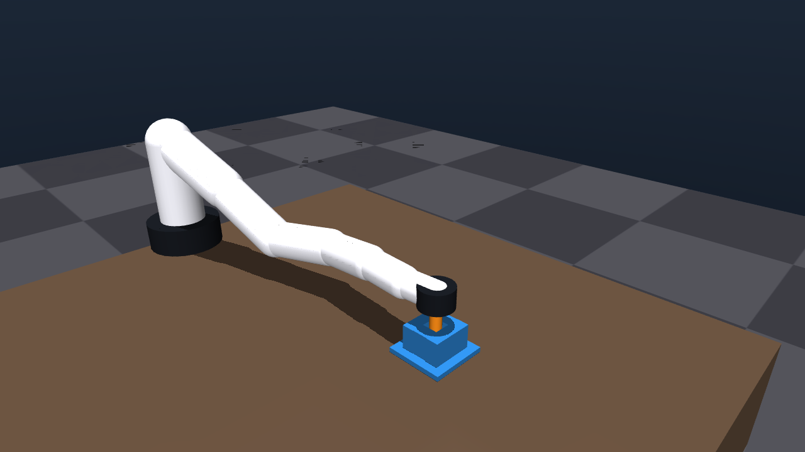
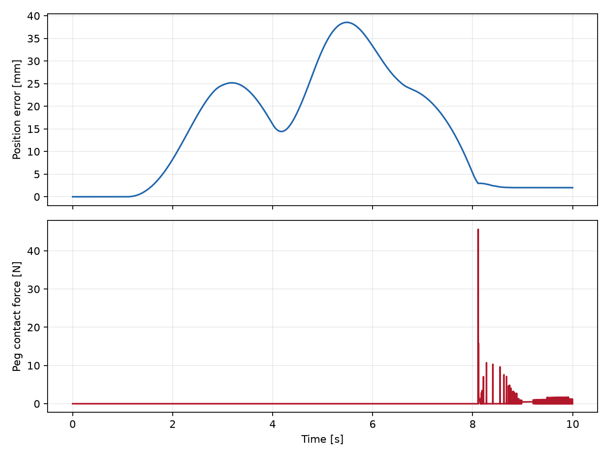
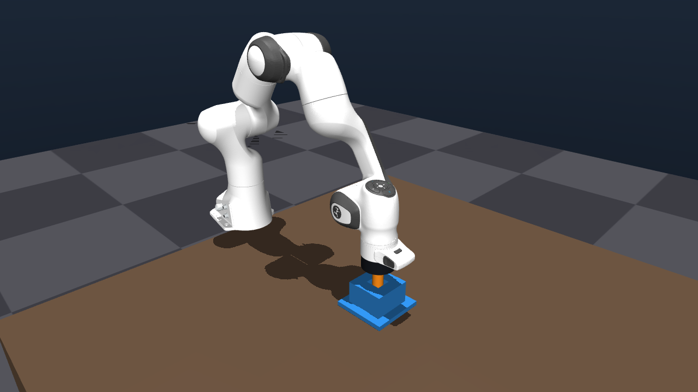
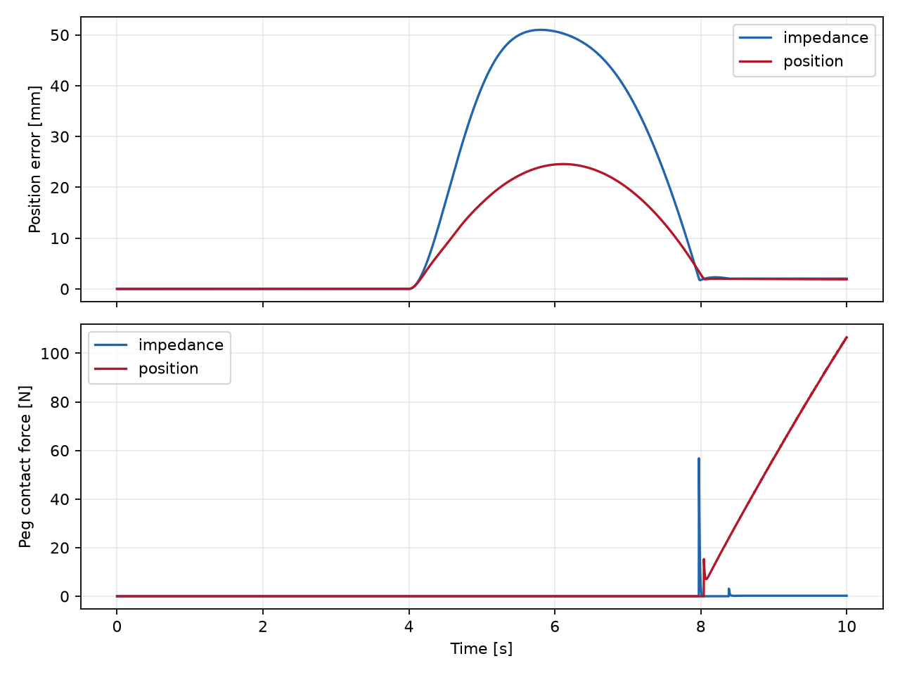
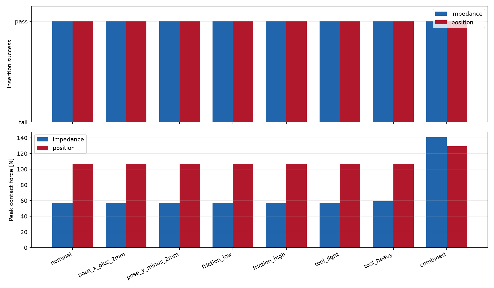
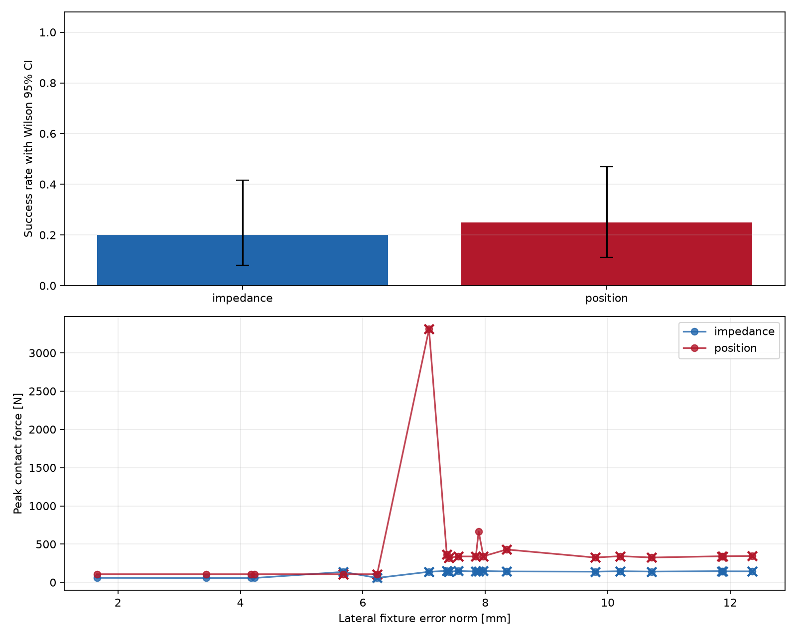
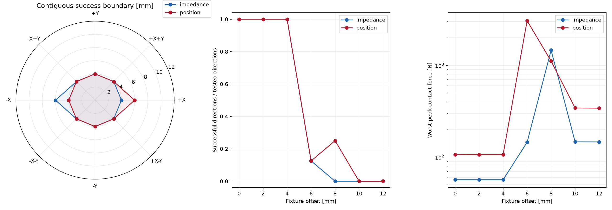
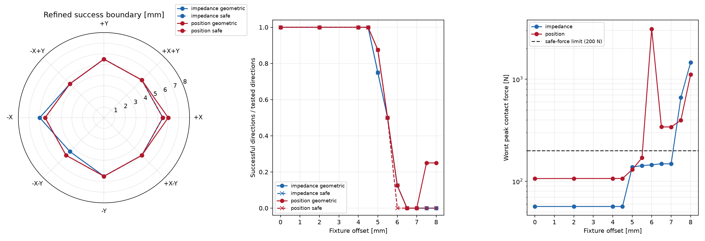
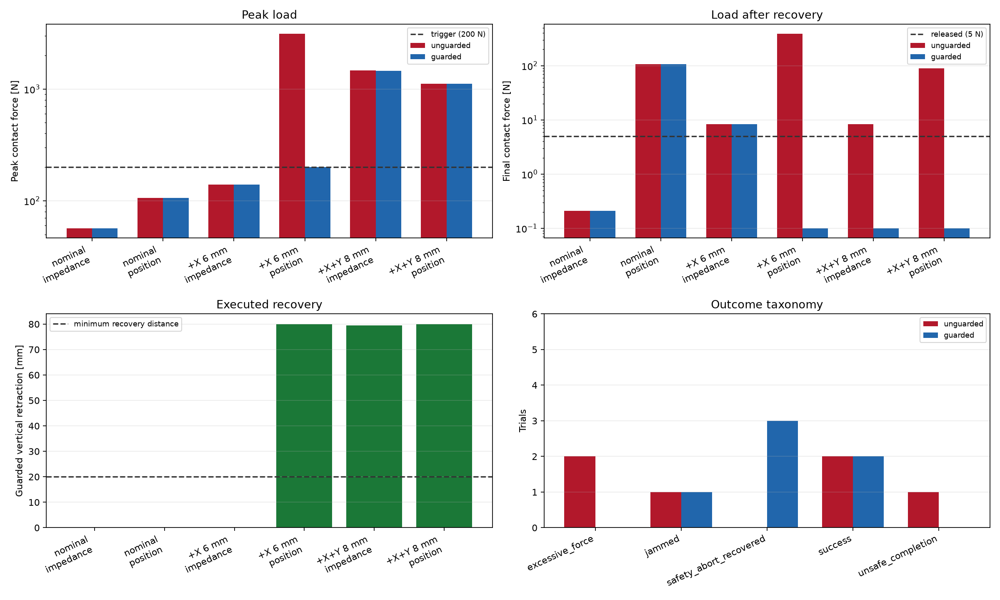
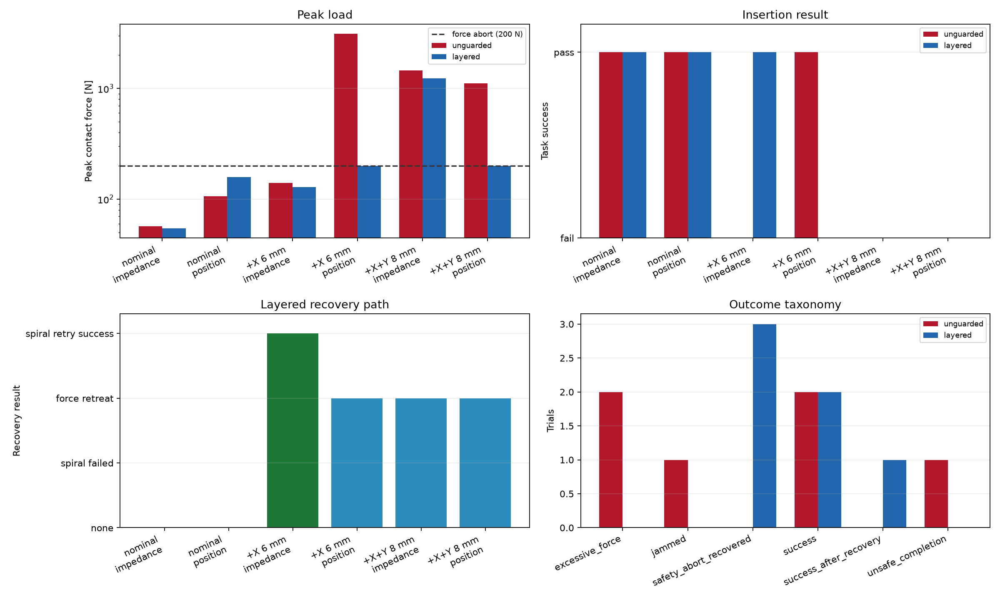

# Franka Panda Contact Assembly

[](https://github.com/haoyu020206-netizen/panda-contact-assembly/actions/workflows/ci.yml)
[](https://www.python.org/)
[](https://mujoco.org/)
[](LICENSE)

A reproducible MuJoCo control benchmark for a 7-DoF Panda arm: joint trajectory tracking, Cartesian impedance control, contact-aware peg-in-hole insertion, and automated robustness evaluation. It includes paired Monte Carlo evaluation, directional failure-boundary mapping, a lightweight development model, and the official MuJoCo Menagerie Franka model.

这是有意收敛范围的 Python + MuJoCo MVP；ROS2、视觉、强化学习和真机部署留作后续扩展。

GitHub Actions 会在标准 Linux runner 上执行 lint、单元测试、轻量模型完整实验、官方模型的关节/笛卡尔/插孔实验和随机扰动对比，并保存可下载的 CSV、JSON 与 PNG 结果，确保仓库不是“只能看、不能跑”的演示代码。

## Verified results




以下结果由 [GitHub Actions run 43959488539](https://github.com/haoyu020206-netizen/panda-contact-assembly/actions/runs/43959488539) 在 Python 3.12 / Ubuntu runner 上重新生成，不是手工填写的示例数据。

| Experiment | Result | Tracking error | Contact / task metric |
| --- | ---: | ---: | ---: |
| Joint trajectory | Pass | RMS **0.0118 rad**, max **0.0245 rad** | 5.0 s run |
| Cartesian impedance | Pass | RMS position **13.1 mm**, RMS orientation **3.14 mrad** | max position error 16.9 mm |
| Nominal peg insertion | Pass | final XY error **0.117 mm** | **45.6 N** peak, **7.852 s**, 58.0 mm depth |
| Robustness batch | **6 / 8 (75%)** | pose, friction, and tool-mass variations | mean peak force 98.6 N |

The asymmetric result is intentional evidence rather than a hidden failure: a +2 mm X fixture error failed while a -2 mm Y error passed, exposing direction-dependent sensitivity in the current kinematics/controller. The 5.5 mm combined disturbance also failed. See the committed [batch data](docs/results/robustness/batch_summary.csv) and [result provenance](docs/results/README.md).



## Official Menagerie baseline



The high-fidelity configuration uses Google DeepMind's official MuJoCo Menagerie Panda arm with upstream inertial, collision, and visual data. The rigid assembly tool and socket are project additions. Results below were regenerated by [GitHub Actions run 43963689044](https://github.com/haoyu020206-netizen/panda-contact-assembly/actions/runs/43963689044).

| Experiment | Result | Tracking error | Contact / task metric |
| --- | ---: | ---: | ---: |
| Joint trajectory | Pass | RMS **0.0039 rad**, max **0.0073 rad** | 5.0 s run |
| Cartesian impedance | Pass | RMS position **2.77 mm**, RMS orientation **0.35 mrad** | max position error 4.79 mm |
| Nominal peg insertion | Pass | final XY error **0.219 mm** | **56.8 N** peak, **7.852 s**, 58.0 mm depth |

The model is pinned to MuJoCo Menagerie commit `370c43965323c0944b433b202aac5058b5f907a9`. Apache-2.0 attribution and the unchanged upstream source are recorded in [THIRD_PARTY_NOTICES.md](THIRD_PARTY_NOTICES.md). This configuration intentionally uses the official no-hand 7-DoF variant because the task mounts a rigid insertion tool instead of operating the parallel gripper.

## Position control vs. impedance control



Both controllers execute the same nominal insertion trajectory on the official Menagerie model. The position baseline uses damped resolved-rate inverse kinematics to generate joint references, followed by a stiff joint PD servo; the impedance controller maps a compliant Cartesian wrench through `Jᵀ`.

| Controller | Success | RMS position error | Peak contact force | Completion time | Final XY error |
| --- | ---: | ---: | ---: | ---: | ---: |
| Cartesian impedance | Pass | 23.7 mm | **56.8 N** | 7.852 s | **0.219 mm** |
| Cartesian position | Pass | **11.4 mm** | 106.6 N | **7.820 s** | 0.249 mm |

The position loop tracked more tightly and completed 32 ms earlier, but produced **49.9 N more peak force (1.88×)**. This is the intended experimental result: tighter geometric tracking is not automatically safer during contact. The values and plot were regenerated by [GitHub Actions run 43965304170](https://github.com/haoyu020206-netizen/panda-contact-assembly/actions/runs/43965304170), with machine-readable evidence under `docs/results/controller-comparison/`.

## Fixed disturbance comparison



The same two controllers were also evaluated across eight deterministic scenarios: nominal, +2 mm X and -2 mm Y pose errors, low/high friction, light/heavy tools, and a combined 5.5 mm pose/high-friction/heavy-tool disturbance.

| Controller | Success | Mean peak force | Worst peak force | Mean completion time |
| --- | ---: | ---: | ---: | ---: |
| Cartesian impedance | **8 / 8** | **67.5 N** | 140.7 N | 7.884 s |
| Cartesian position | **8 / 8** | 109.4 N | **129.1 N** | **7.821 s** |

Both controllers passed this fixed matrix, so it does not establish a success-rate advantage. Position control produced **1.62×** the mean peak force, while impedance control had the lower peak in seven of eight scenarios. The combined disturbance is the important counterexample: lateral impact raised the impedance peak above the position baseline. Friction-only cases remained centered and therefore did not materially excite wall friction. These are deterministic regression results, not confidence intervals. Evidence comes from [GitHub Actions run 44169284923](https://github.com/haoyu020206-netizen/panda-contact-assembly/actions/runs/44169284923).

## Seeded Monte Carlo comparison



Both controllers were evaluated on the same 20 sampled disturbances (`seed = 20261117`). Fixture X/Y errors were sampled independently from ±10 mm, friction scale from 0.6–1.4, and tool-mass scale from 0.8–1.2.

| Controller | Success rate (Wilson 95% CI) | Mean peak force (95% CI) | Worst peak force |
| --- | ---: | ---: | ---: |
| Cartesian impedance | 4/20, **20%** (8.1–41.6%) | **122.0 N** (105.2–138.7 N) | **150.5 N** |
| Cartesian position | 5/20, 25% (11.2–46.9%) | 438.6 N (135.8–741.5 N) | 3310.3 N |

The success intervals overlap substantially, so this initial sample does **not** establish a success-rate winner. Paired outcomes were: both succeeded in 4 cases, position only in 1, impedance only in 0, and neither in 15. The meaningful difference is contact severity: the position controller averaged **316.7 N more peak force per paired trial** and produced a 3.31 kN simulated impact while jammed; the impedance controller stayed below 151 N. These simulation forces are comparative metrics, not hardware predictions. Full evidence comes from [GitHub Actions run 44173170765](https://github.com/haoyu020206-netizen/panda-contact-assembly/actions/runs/44173170765) and is committed under `docs/results/monte-carlo/`.

## Directional failure boundary



A deterministic radial scan holds friction and tool mass at their nominal values while moving the socket in eight directions from 0–12 mm in 2 mm steps. The boundary is the largest tested offset for which every smaller offset in the same direction also succeeds.

| Direction | Impedance boundary | Position boundary |
| --- | ---: | ---: |
| +X | 4 mm (first fail: 6 mm) | **6 mm** (first fail: 8 mm) |
| +X+Y | 4 mm (first fail: 6 mm) | 4 mm (first fail: 6 mm) |
| +Y | 4 mm (first fail: 6 mm) | 4 mm (first fail: 6 mm) |
| -X+Y | 4 mm (first fail: 6 mm) | 4 mm (first fail: 6 mm) |
| -X | **6 mm** (first fail: 8 mm) | 4 mm (first fail: 6 mm) |
| -X-Y | 4 mm (first fail: 6 mm) | 4 mm (first fail: 6 mm) |
| -Y | 4 mm (first fail: 6 mm) | 4 mm (first fail: 6 mm) |
| +X-Y | 4 mm (first fail: 6 mm) | 4 mm (first fail: 6 mm) |

Both controllers therefore have a **4 mm contiguous success radius across all eight tested directions** at this scan resolution. At 6 mm, each succeeds in only one of eight directions, but in opposite directions. Position control also re-entered geometric success at 8 mm in two diagonal directions after failing at 6 mm; those non-monotonic cases required 872–886 N and are not evidence of a reliable larger boundary. Worst scan forces were **1.46 kN for impedance** and **3.07 kN for position**, showing that even impedance control can generate severe simulated loads when a diagonal contact jams. These are geometric simulation boundaries, not hardware tolerances or safety certifications. Evidence comes from [GitHub Actions run 44175719284](https://github.com/haoyu020206-netizen/panda-contact-assembly/actions/runs/44175719284).

## Refined geometric and safe boundary



The 4–8 mm transition region was then rescanned at 0.5 mm resolution. An exploratory `safe_success` metric requires geometric success and a simulated peak contact force no greater than 200 N. This threshold separates low-force insertion from contact-driven high-force insertion; it is configurable and is **not** a hardware safety limit.

| Direction | Impedance geometric / safe | Position geometric / safe |
| --- | ---: | ---: |
| +X | 5.5 / 5.5 mm | 6.0 / **5.5 mm** |
| +X+Y | 5.0 / 5.0 mm | 5.0 / 5.0 mm |
| +Y | 5.5 / 5.5 mm | 5.5 / 5.5 mm |
| -X+Y | 4.5 / 4.5 mm | 4.5 / 4.5 mm |
| -X | **6.0 / 6.0 mm** | 5.5 / 5.5 mm |
| -X-Y | 4.5 / 4.5 mm | 5.0 / 5.0 mm |
| -Y | 5.5 / 5.5 mm | 5.5 / 5.5 mm |
| +X-Y | 5.0 / 5.0 mm | 5.0 / 5.0 mm |

Both controllers have a **4.5 mm contiguous radius across all eight tested directions**. Impedance control's 36 geometric successes all remained below 200 N. Position control recorded 41 geometric successes, but five were rejected as unsafe; at 6 mm its only geometric success reached **3.11 kN**, giving 0/8 safe successes versus 1/8 for impedance. At 7.5 and 8 mm, position control again produced two geometric successes but zero safe successes. This is the clearest result of the project so far: geometric completion alone can reward damaging contact. Evidence comes from [GitHub Actions run 44180056892](https://github.com/haoyu020206-netizen/panda-contact-assembly/actions/runs/44180056892).

## Force-triggered stop and retract



A force supervisor now monitors every 2 ms control sample. When the simulated peg contact force reaches the exploratory 200 N threshold, it latches the event, resets the resolved-rate position controller's accumulated joint reference, holds for 50 ms, and commands an 80 mm minimum-jerk vertical retreat. Outcomes are classified as normal success, unsafe completion, recovered safety abort, excessive-force failure, jam, lateral misalignment, or insufficient depth.

| Scenario / controller | Unguarded peak / final force | Guarded peak / final force | Guarded result |
| --- | ---: | ---: | --- |
| nominal / impedance | 56.8 / 0.2 N | 56.8 / 0.2 N | success, no trigger |
| nominal / position | 106.5 / 106.5 N | 106.5 / 106.5 N | success, no trigger |
| +X 6 mm / impedance | 140.0 / 8.3 N | 140.0 / 8.3 N | jam below threshold, no trigger |
| +X 6 mm / position | **3111.9 / 385.2 N** | **200.8 / 0.0 N** | triggered, recovered 80.0 mm |
| +X+Y 8 mm / impedance | 1461.9 / 8.3 N | 1451.3 / 0.0 N | triggered, recovered 79.4 mm |
| +X+Y 8 mm / position | 1112.6 / 89.5 N | 1112.6 / 0.0 N | triggered, recovered 80.0 mm |

All three guarded trials that exceeded the threshold released contact and completed the configured retreat. The +X 6 mm position-control case is the strongest result: recovery reduced the peak by **93.5%** and prevented a 3.11 kN unsafe geometric completion. The diagonal impacts expose the limitation of reactive thresholding: the first detected 2 ms sample was already 1.11–1.22 kN, so retreat cleared the sustained load but could not undo the instantaneous peak. The 140 N impedance jam also remained below the trigger threshold. Predictive contact slowing and jam timeouts are therefore still required. These simulated thresholds are not hardware safety limits. Evidence comes from [GitHub Actions run 44348538833](https://github.com/haoyu020206-netizen/panda-contact-assembly/actions/runs/44348538833).

## Contact-aware spiral retry



The insertion policy now layers three mechanisms: 0.20 m/s free-space approach with 0.005 m/s pre-contact and 0.0015 m/s contact speed limits; a 5 N, 0.6 s low-progress jam timeout followed by 15 mm local retraction and a four-turn, 8 mm-radius spiral; and the existing 200 N stop-and-retreat supervisor as the final guard. The same six controller/scenario combinations were run both unguarded and layered.

| Scenario / controller | Unguarded result | Layered result |
| --- | --- | --- |
| nominal / impedance | success, 56.8 N peak | success, 54.5 N peak |
| nominal / position | success, 106.5 N peak | success, 157.9 N peak |
| +X 6 mm / impedance | jammed, 140.0 N peak | **spiral retry success**, 128.9 N peak |
| +X 6 mm / position | unsafe completion, 3111.9 N peak | safety abort recovered, 200.0 N peak |
| +X+Y 8 mm / impedance | excessive force, 1461.9 N peak | safety abort recovered, 1235.5 N peak |
| +X+Y 8 mm / position | excessive force, 1112.6 N peak | safety abort recovered, 200.1 N peak |

Both nominal layered trials completed without false recovery. In the known +X 6 mm impedance jam, the controller detected low progress at **12.096 s**, retracted, found the entry during spiral search, and completed the retry at **17.290 s** with 58.0 mm final depth and 0.21 N final contact force. All three high-force aborts released contact, retracted at least 80 mm, and ended at 0 N. The layered matrix therefore produced three safe task successes, including one success after recovery, plus three verified safety aborts.

This is not a universal force reduction: nominal position control rose from 106.5 N to 157.9 N, and the diagonal impedance collision still reached 1.24 kN before the reactive supervisor could act. The next control improvement must target approach velocity or force-rate prediction before first impact. The 200 N threshold remains an exploratory simulation criterion, not a hardware safety limit. Evidence and seven executable acceptance checks come from [GitHub Actions run 44356954129](https://github.com/haoyu020206-netizen/panda-contact-assembly/actions/runs/44356954129).

## 已实现

- 自带无网格依赖的 7-DoF Panda 风格 MJCF，可立即验证控制代码；
- 可选官方 MuJoCo Menagerie Panda 模型，保留真实链节惯量、碰撞网格和视觉网格；
- 五次多项式关节轨迹与带偏置力补偿的 PD 力矩控制；
- 末端 Jacobian、位置/姿态误差、笛卡尔阻抗与零空间姿态控制；
- 阻尼伪逆笛卡尔位置环与高刚度关节伺服，可和阻抗控制同条件对比；
- 两种控制器在同一组位姿、摩擦和质量扰动下的配对批量实验；
- 固定随机种子的 20 组配对 Monte Carlo 实验、Wilson 成功率区间和接触力均值区间；
- 八方向、0–12 mm 的失效边界扫描，以及非单调成功检测；
- 4–8 mm、0.5 mm 分辨率的边界细化，以及 200 N 探索性安全成功判据；
- 接触力超限锁存、停止、位置环参考复位与最小加加速度竖直回撤；
- 自由空间/近孔/接触三段轴向限速，以及低力卡住进度超时判定；
- 局部回撤、阿基米德螺旋寻孔、入口识别和竖直重插状态机；
- 12 组无保护/分层恢复对照，以及由 7 条任务级指标约束的 CI 验收；
- 正常成功、危险成功、安全中止、卡住、偏孔和深度不足的失败类型统计；
- 方孔插入任务、接触力读取和成功判据；
- 孔位、摩擦和工具质量扰动的批量实验；
- CSV 时序数据、JSON 摘要和可选 PNG 曲线；
- 单元测试和命令行入口。

`configs/mvp.toml` 使用快速、无网格依赖的回归模型；`configs/menagerie.toml` 使用官方 Franka 模型。两者共享控制器和任务接口，但指标不能被解释为真机性能。

## 环境

推荐 Python 3.11–3.14。一般情况下，Windows PowerShell 可在项目内创建环境：

```powershell
py -3.12 -m venv .venv
.\.venv\Scripts\Activate.ps1
python -m pip install --upgrade pip
python -m pip install -e ".[dev]"
pytest
```

如果本机只有更新的 Python，可先尝试安装；若 MuJoCo 尚未提供对应 wheel，再安装 Python 3.12。

如果出现“应用程序控制策略已阻止此文件”的 NumPy DLL 错误，这来自 Windows Smart App Control/企业签名策略，而不是项目路径。请在允许第三方原生扩展的 Python、WSL2 或开发容器中运行；GitHub Actions 提供独立的 Linux 验收路径。

## 运行

先做无界面验收：

```powershell
python -m panda_assembly joint --output runs\joint_smoke
python -m panda_assembly cartesian --output runs\cartesian_smoke
python -m panda_assembly peg --output runs\peg_smoke
python -m panda_assembly batch --output runs\robustness_mvp
```

运行官方 Menagerie 模型基线：

```powershell
python -m panda_assembly joint --config configs\menagerie.toml --output runs\menagerie_joint
python -m panda_assembly cartesian --config configs\menagerie.toml --output runs\menagerie_cartesian
python -m panda_assembly peg --config configs\menagerie.toml --output runs\menagerie_peg
```

自动运行位置/阻抗控制对比并生成叠加曲线：

```powershell
python -m panda_assembly compare --config configs\menagerie.toml --output runs\controller_comparison
```

运行 8 个固定扰动场景下的配对对比：

```powershell
python -m panda_assembly compare-batch --config configs\menagerie.toml --output runs\controller_robustness
```

运行固定种子的 20 组随机扰动配对实验：

```powershell
python -m panda_assembly monte-carlo --config configs\menagerie.toml --output runs\monte_carlo
```

运行八方向孔位偏差边界扫描：

```powershell
python -m panda_assembly boundary-scan --config configs\menagerie.toml --output runs\boundary_scan
```

细化边界并区分几何成功与安全成功：

```powershell
python -m panda_assembly boundary-refine --config configs\menagerie.toml --output runs\boundary_refinement
```

运行危险偏差下的无保护/带回撤策略对照：

```powershell
python -m panda_assembly safety-recovery --config configs\menagerie.toml --output runs\safety_recovery
```

运行接近限速、低力卡住检测、螺旋寻孔、重插和高力回撤的分层对照：

```powershell
python -m panda_assembly contact-recovery --config configs\menagerie.toml --output runs\contact_recovery
python scripts\validate_contact_recovery.py runs\contact_recovery\contact_recovery_summary.json
```

也可以单独运行位置控制：

```powershell
python -m panda_assembly peg --controller position --config configs\menagerie.toml
```

观察单次实验：

```powershell
python -m panda_assembly peg --viewer
```

每次运行生成：

```text
runs/<experiment>/
├── summary.json       # 成功率相关指标、RMS/最大误差、最大接触力、完成时间
├── timeseries.csv     # 可复核的逐步记录
└── metrics.png        # 误差与接触力曲线（安装 matplotlib 时）
```

批量实验额外生成 `batch_summary.csv` 与 `aggregate.json`。Monte Carlo 模式生成 `monte_carlo_trials.csv`、`monte_carlo_summary.json` 与带置信区间的 `monte_carlo_summary.png`；粗扫描、细化扫描、安全回撤和接触恢复对照分别生成逐工况 CSV、JSON 摘要和汇总图。

## 指标定义

- `success`：peg tip 的横向误差不超过配置的 clearance，且插入深度达到 `insertion_depth`；控制器会继续向 `target_depth` 运动，从而在孔底形成可测量的接触力；
- `rms_position_error_m`：控制周期内末端位置误差的均方根；
- `rms_joint_error_rad`：关节实验中 7 轴误差向量范数的均方根；
- `rms_orientation_error_rad`：笛卡尔/插孔实验中的末端姿态误差均方根；
- `max_contact_force_n`：peg 所有接触点法向/切向合力范数之和的最大值；
- `completion_time_s`：首次同时满足横向误差和插入深度阈值的仿真时间；
- `final_xy_error_m`、`final_insertion_depth_m`：最终装配几何误差。
- `outcome`、`failure_type`：装配结果和主要失败类型；
- `safety_trigger_time_s`、`safety_trigger_force_n`：安全状态机锁存时刻与采样力；
- `retraction_distance_m`、`safety_recovered`：实际竖直回撤距离，以及是否同时满足解除接触和最小回撤条件。
- `contact_recovery_triggered`、`jam_detected_time_s`、`recovery_attempts`：低力卡住恢复是否触发、触发时刻与尝试次数；
- `spiral_entry_detected`、`retry_success`：螺旋是否找到入口，以及后续重插是否达到成功判据。

配置集中在 `configs/mvp.toml` 和 `configs/menagerie.toml`。调整刚度时同步检查阻尼、力矩饱和、峰值接触力与仿真稳定性，不要只追求成功率。

## 项目结构

```text
configs/mvp.toml                 # 轻量回归模型配置
configs/menagerie.toml           # 官方 Panda 模型配置
src/panda_assembly/
├── assets/panda_mvp.xml         # 轻量化 7-DoF 模型与插孔工装
├── assets/panda_menagerie.xml   # 基于官方 Panda 的高保真装配场景
├── assets/menagerie/             # 固定版本的官方模型、网格与许可证
├── controllers.py               # 关节 PD / 笛卡尔位置 / 笛卡尔阻抗
├── experiments.py               # 单次、固定扰动和 Monte Carlo 实验编排
├── math_utils.py                # 姿态误差与阻尼零空间投影
├── metrics.py                   # 指标、CSV、JSON、曲线
├── model.py                     # 模型加载与接口校验
├── safety.py                    # 接近限速、卡住/螺旋重试、高力回撤与失败分类
└── trajectories.py              # 五次多项式轨迹
tests/                            # 配置、数学、轨迹与模型测试
```

## 五周里程碑

1. 环境、模型编译、关节轨迹 smoke test；
2. 对比不同 `Kp/Kd` 的跟踪误差与力矩饱和；
3. 验证 Jacobian 与笛卡尔阻抗，记录位置/姿态阶跃响应；
4. 插孔接触、成功判据、孔位/摩擦/质量扰动；
5. 固化实验种子和配置，补结果表、README 图与两分钟演示视频（数据与图已完成）。

## 后续升级顺序

1. 加入力变化率/接触距离预测和横向速度限制，降低单个控制周期内的瞬时冲击；
2. 对限速、卡住阈值、螺旋半径和搜索时间做参数敏感性与消融实验；
3. 把分层恢复加入固定种子 Monte Carlo，报告恢复成功率和代价分布；
4. 考试后再接 ROS2/`ros2_control`、MoveIt2 与 residual RL。

## 简历表述

> Developed and evaluated Cartesian impedance control for contact-rich manipulation with a 7-DoF Franka Panda in MuJoCo, including automated robustness testing under pose, mass, and friction variations.

